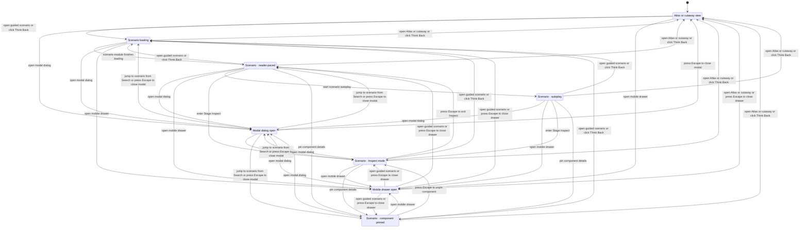
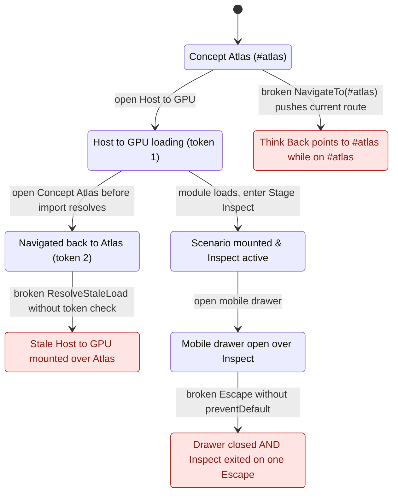
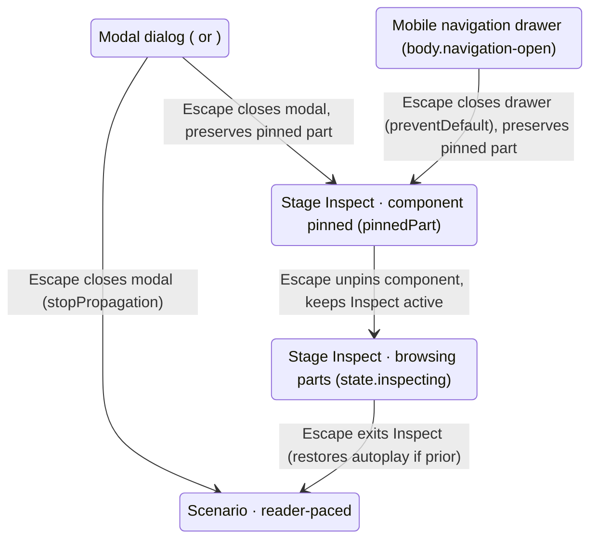

# Navigation, async lesson mount, and overlay Escape

Fixed `/statechart` overview for `src/main.ts`, `src/catalog.ts`, `src/platform/search.ts`, and `src/stage/player.ts`. The projection groups Atlas and Explore cutaway routes (`s0`), collapses superseded background imports that `lessonLoadToken` discards, and separates modal dialogs (`s2`), the mobile drawer (`s3`), and the four scenario stage states (`s4`–`s7`). Notice there is no arrow from `s2` or `s3` back to `s5` (`Scenario · autoplay`): opening Search, Evidence, or the mobile drawer pauses active scenario autoplay (`OverlayExclusivityAndPause`).

## Shortest counterexamples in the broken variants

This view combines the shortest counterexamples reported by TLC across `stale_mount`, `trail_loop`, and `escape_leak`. Red states indicate the first invariant violation in each negative variant.

- `stale_mount`: violates `MountedMatchesActiveLesson` on step 3 (`NavLessonGpu` → `NavAtlas` → `ResolveStaleLoad`). Without `token === lessonLoadToken` in `ensureLessonMounted`, an older dynamic `import()` resolving after leaving `#lesson/host-to-gpu` (or re-entering it after visiting `#atlas`) mounts over the wrong view or leaks a duplicate `MountedStageScenario`.
- `trail_loop`: violates `BackNeverSelfLoops` when `pushTrail` records the destination route or when an in-place subject switch (`#a30/memory` → `#a30` → subject-picker `memory`) leaves `#a30/memory` at the top of `trail`. `pruneTrailForDestination` in `src/catalog.ts` strips trailing destination matches so `Think Back` never points to the current route.
- `escape_leak`: violates `OverlayEscapeIsolation` on step 5 (`NavLessonGpu` → `ResolveCurrentLoad` → `EnterStageInspect` → `OpenDrawer` → `PressEscape`). In `src/main.ts`, `#sidebar` calls `event.preventDefault()` before `closeNavigation(true)` removes `.navigation-open`, ensuring the bubbling `keydown` event is ignored by `src/stage/player.ts` (`if (event.defaultPrevented ...) return`) instead of simultaneously exiting Stage Inspect.

## Close-up: layered Escape stack

Each `Escape` press peels exactly one active surface from top to bottom without disturbing underlying stage or route state:

