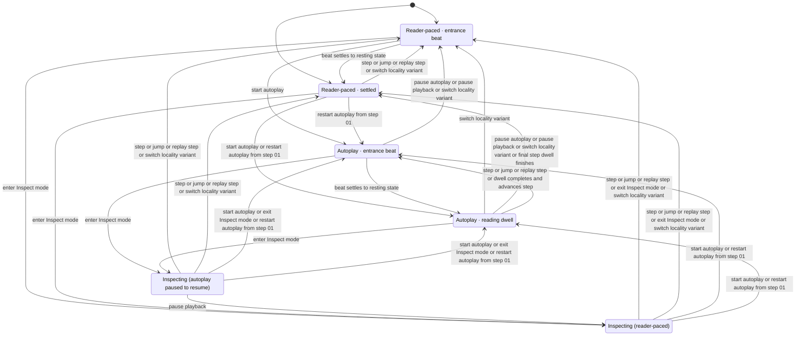
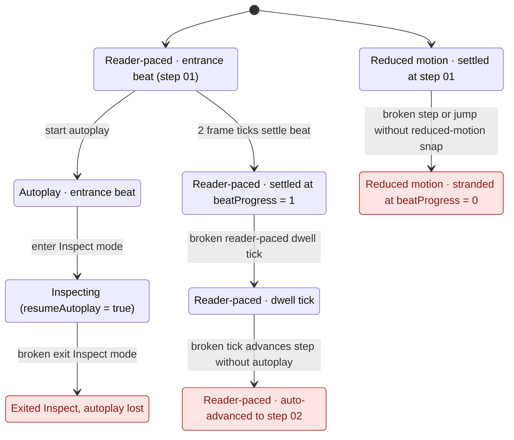

# Stage scenario runner

Fixed `/statechart` overview for `reduceRunnerState` (`src/stage/runner.ts`). The projection collapses step indices (`0..2`), reading-dwell sub-ticks, and `Local` vs. `Cross-socket` variants so playback, causal entrance beats, and `Inspect` pause/resume appear directly. Standard motion enters at `s0` (`beatProgress = 0`); `prefers-reduced-motion: reduce` enters immediately at `s1` (`beatProgress = 1`).

## Shortest counterexamples in the broken variants

This chart combines the shortest counterexample traces found by TLC across `inspect_clobber`, `reduced_stall`, and `reader_drift`. Red marks the first invariant violation in each negative variant, not a current implementation bug.

- `inspect_clobber`: violates `InspectPreservesContext` on step 3 (`ToggleAutoplay` → `EnterInspect` → `ToggleInspect`). Entering Inspect pauses active autoplay into `resumeAutoplayAfterInspect`; leaving Inspect via `toggle-inspect` must restore `autoplay` without advancing `stepIndex`. Explicit `pause` (`s5 --> s3` in the overview) clears `resumeAutoplayAfterInspect` so background tab hides or modal opens never restart autoplay unexpectedly.
- `reduced_stall`: violates `ReducedMotionSettlesImmediately` on step 1 (`Init(reducedMotion = TRUE)` → `GotoFirst`). Under `prefers-reduced-motion: reduce`, `freshBeat` and `tick` snap `beatProgress` to `1` immediately while still advancing autoplay after reading dwell.
- `reader_drift`: violates `ReaderPacedNeverAutoAdvances` on step 4 (`Tick` settles beat → `Tick` accumulates dwell → `Tick` advances step while `autoplay = false`). In `reduceRunnerState`, reader-paced steps rest indefinitely at `beatProgress = 1` until the learner steps manually or enables Autoplay.
